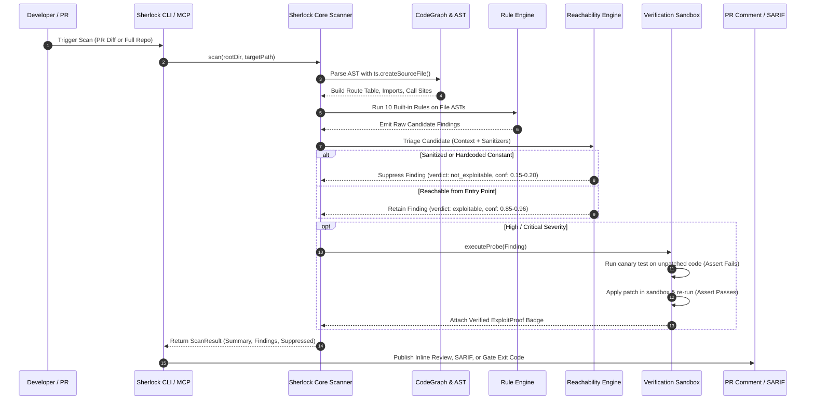

# Sherlock: Repository Structure & Architecture Specification

**Document ID:** `AUD-DOC-01`  
**Product:** Sherlock AI Code Review & Security Verification Platform  
**Target Architecture:** Monorepo (Node.js, TypeScript, React 18, Vite, MCP SDK)  
**Evaluator:** Principal Systems Architect  
**Date:** October 2026  
**Status:** Verified Baseline  

---

## 1. Monorepo Structure & Package Inventory

Sherlock is structured as an npm workspaces monorepo with 6 cohesive TypeScript packages and 2 benchmark verification targets:

```
sherlock-monorepo/
├── .github/                      # CI workflows (GitHub Actions)
├── .secreview.yml                # Repository-level security policy and gate configuration
├── package.json                  # Root workspace configuration
├── tsconfig.json                 # Base TypeScript compiler settings
├── benchmark/
│   ├── vulnerable-app/           # Target vulnerable Express/React testbed (CWE-89, 78, 22, 918, 79, 862)
│   └── safe-app/                 # False-positive verification testbed (parameterized, sanitized)
└── packages/
    ├── core/                     # @sherlock/core: AST parsing, CodeGraph, Built-in rules, Reachability
    ├── review/                   # @sherlock/review: Walkthrough summaries, Mermaid diagrams, Chat, Learnings
    ├── verification/             # @sherlock/verification: Exploit proofs, Canary probes, Sandbox runner
    ├── mcp/                      # @sherlock/mcp: Model Context Protocol stdio server for AI IDEs
    ├── cli/                      # @sherlock/cli: Developer CLI, CI gating, SARIF/JSON outputs
    └── dashboard/                # @sherlock/dashboard: React 18 / Vite single-page application
```

### Package Responsibilities & Dependencies

| Package | Name | Primary Responsibility | Dependencies | Exported Binaries / Interfaces |
| :--- | :--- | :--- | :--- | :--- |
| `packages/core` | `@sherlock/core` | AST traversal via TypeScript compiler API, symbol indexing, call graph, route extraction, taint analysis, reachability triage, finding fingerprinting, SARIF/Markdown formatters. | `typescript`, `yaml` | `SherlockScanner`, `CodeGraph`, `ReachabilityEngine`, `toSarif`, `toMarkdownSummary` |
| `packages/review` | `@sherlock/review` | PR diff walkthrough generation, per-file risk evaluation, Mermaid sequence/flowchart generation, conversational `@sherlock` chat parsing, and repository learnings store (`.sherlock-learnings.json`). | `@sherlock/core` | `generatePRReview`, `PRChatHandler`, `LearningsStore`, `generateMermaidDiagram` |
| `packages/verification` | `@sherlock/verification` | Exploit proof generation, canary probe execution, in-memory patch testing, unit/regression test generation. | `@sherlock/core` | `synthesizeExploitProof`, `VerificationSandbox`, `generateRegressionUnitTest` |
| `packages/mcp` | `@sherlock/mcp` | Model Context Protocol server exposing 9 tools over stdio for Cursor, Claude Code, Windsurf, and VS Code. | `@sherlock/core`, `@sherlock/review`, `@sherlock/verification` | `SherlockMCPServer`, `sherlock-mcp` bin |
| `packages/cli` | `@sherlock/cli` | Command-line runner for `scan`, `proof`, `test`, `review`, `mcp`, `init`, and CI gate evaluation. | `@sherlock/core`, `@sherlock/review`, `@sherlock/verification`, `@sherlock/mcp`, `commander`, `picocolors` | `sherlock` bin |
| `packages/dashboard` | `@sherlock/dashboard` | Web application with dark/light themes, command palette, findings inbox, interactive diff viewer, autonomous test dashboard, debug loops, and settings. | `@sherlock/core`, `@sherlock/review`, `@sherlock/verification`, React 18, Vite, Tailwind CSS v4, Lucide, Recharts | Web app running on port 3000 |

---

## 2. High-Level System Architecture Diagram

```mermaid
flowchart TD
    subgraph DeveloperSurfaces["Developer & Agent Surfaces"]
        GH[GitHub PR Bot / Actions]
        IDE[VS Code / Cursor / Windsurf]
        CLI[Sherlock CLI (npx @sherlock/cli)]
        DASH[Web Dashboard (React / Vite)]
    end

    subgraph IntegrationLayer["Gateway & Transport Layer"]
        MCP[Sherlock MCP Server (stdio)]
        API[Dashboard Vite API Middleware / Express]
        CONF[Config Loader (.secreview.yml)]
    end

    subgraph ThreeEngines["Sherlock Core Engines"]
        subgraph SecurityEngine["Security Engine (Core)"]
            AST[TypeScript AST Traversal]
            CG[CodeGraph & Route Table]
            RULES[Built-in Security Rules (10 Classes)]
            TRIAGE[Reachability & Sanitizer Triage]
            FPRINT[SHA-256 Fingerprint Generator]
        end

        subgraph ReviewEngine["Review Engine"]
            SUM[Walkthrough & Risk Evaluator]
            DIAG[Mermaid Flow & Sequence Gen]
            CHAT[PR Chat Command Handler]
            LRN[Repository Learnings Store]
        end

        subgraph VerificationEngine["Verification Engine"]
            PROOF[Canary Probe Synthesizer]
            SANDBOX[In-Memory Verification Sandbox]
            TESTGEN[Regression Test Generator]
        end
    end

    subgraph StorageArtifacts["State & Output Artifacts"]
        SARIF[SARIF 2.1.0 / JSON Exports]
        LEARN_DB[.sherlock-learnings.json]
        CACHE[Scan Result Cache]
    end

    GH --> CLI
    IDE --> MCP
    CLI --> SecurityEngine
    CLI --> ReviewEngine
    CLI --> VerificationEngine
    MCP --> SecurityEngine
    MCP --> ReviewEngine
    MCP --> VerificationEngine
    DASH --> API
    API --> SecurityEngine
    CONF --> SecurityEngine

    AST --> CG
    CG --> RULES
    RULES --> TRIAGE
    TRIAGE --> FPRINT
    FPRINT --> SUM
    FPRINT --> PROOF

    PROOF --> SANDBOX
    SANDBOX --> TESTGEN
    CHAT --> LRN
    LRN --> LEARN_DB
    SecurityEngine --> SARIF
    SecurityEngine --> CACHE
```

---

## 3. End-to-End Data Flow Architecture

The data pipeline progresses through 7 rigorous phases from ingestion to publication:



---

## 4. Single Point of Failure (SPOF) & Architectural Risks

1. **In-Process AST Memory Footprint:**
   - *Risk:* Loading very large repositories (>10,000 files) into memory via `ts.createSourceFile()` synchronously could cause heap exhaustion.
   - *Mitigation:* Chunked file processing and incremental scanning based on Git diff changesets (SC-3).
2. **Local Sandbox Execution Safety:**
   - *Risk:* Executing generated exploit proofs in the host Node.js process without container isolation could theoretically execute arbitrary code if untrusted repo contents alter node globals.
   - *Mitigation:* PRD Section 20.3 specifies microVM / gVisor isolation with network egress blocked and synthetic environment variables for production cloud runners.
3. **Synchronous File I/O in Learnings Store:**
   - *Risk:* Concurrent PR review threads reading and writing `.sherlock-learnings.json` simultaneously could encounter race conditions.
   - *Mitigation:* File-locking or database-backed persistence for multi-tenant SaaS deployment.
