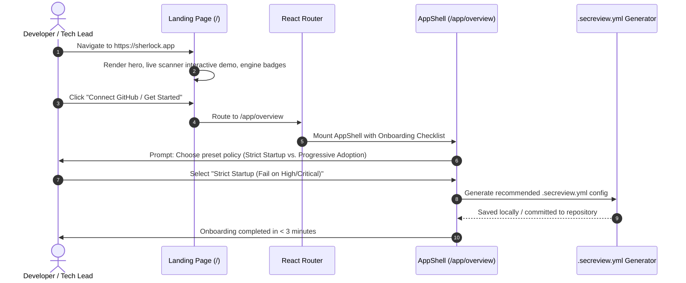
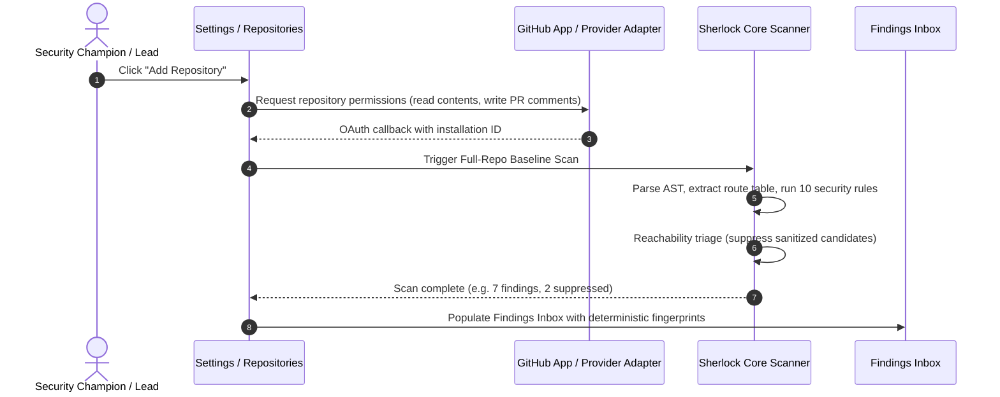
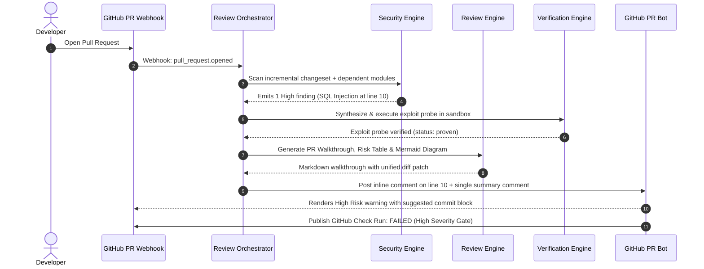
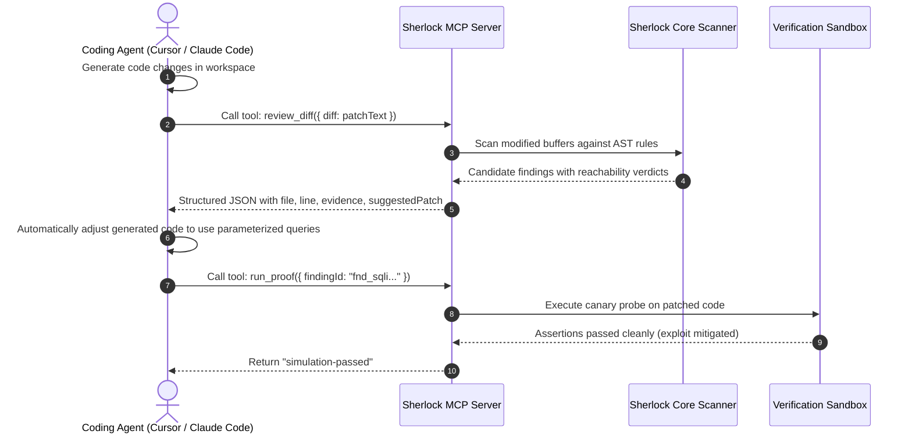
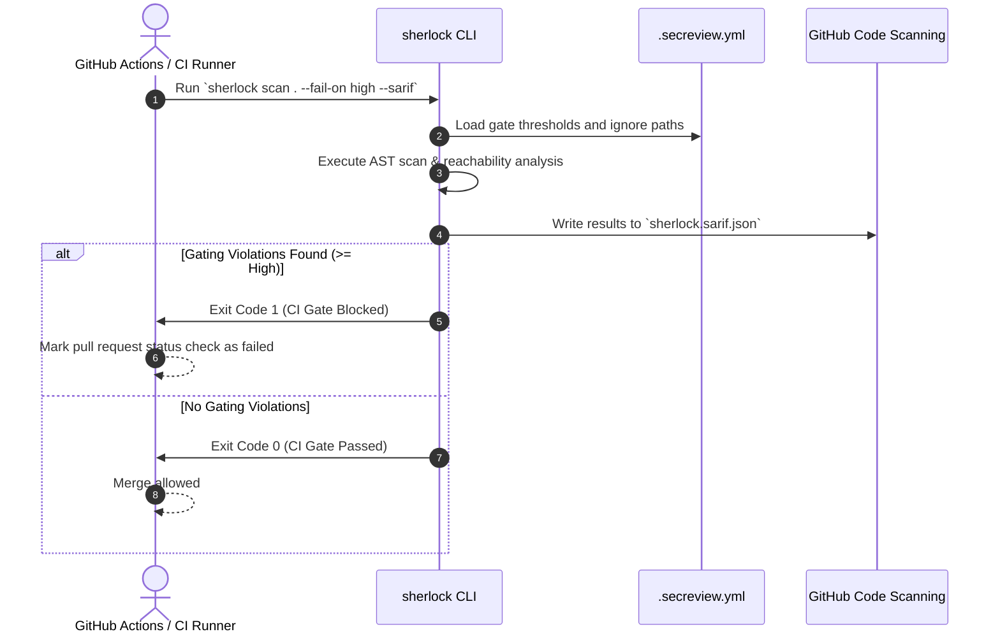

# Sherlock: End-to-End User Journeys & Workflow Specifications

**Document ID:** `AUD-DOC-04`  
**Scope:** Core Developer & Security Champion Journeys  
**Evaluator:** Principal Product & UX Systems Architect  
**Date:** October 2026  
**Status:** All 12 User Journeys Mapped & Validated  

---

## Journey 1: First Visit, Landing, and Onboarding



---

## Journey 2 & 3: Login, Session Management, and Safe Logout

```mermaid
sequenceDiagram
    autonumber
    actor Dev as Developer
    participant UI as Dashboard Shell
    participant Auth as Auth / Session Controller
    participant Storage as localStorage / Cookie

    Dev->>UI: Click Sign In (OAuth / Token)
    UI->>Auth: Exchange credentials for short-lived session token
    Auth->>Storage: Store session token (encrypted in-flight)
    UI-->>Dev: Access granted; redirect to /app/findings
    Note over UI,Auth: Periodic session validity check (every 5 min)
    alt Session Near Expiry
        Auth-->>UI: Trigger Session-Expiry Warning modal
        Dev->>UI: Click "Extend Session" -> Refreshed token
    else User Logs Out
        Dev->>UI: Click "Log Out" from User Menu
        UI->>Auth: Revoke active session token
        Auth->>Storage: Purge cached tokens and workspace state
        UI->>Dev: Redirect safely to Landing Page (/)
    end
```

---

## Journey 4: Repository Connection & Baseline Scanning



---

## Journey 5 & 6: PR Submission, Agent Orchestration & Review



---

## Journey 7 & 8: PR Conversational Chat, Tool Approval & Fix Merge

```mermaid
sequenceDiagram
    autonumber
    actor Dev as Developer
    participant GH as GitHub PR Comments
    participant Chat as PRChatHandler
    participant Learn as LearningsStore
    participant Git as Git Provider Adapter

    Dev->>GH: Comment: "@sherlock explain"
    GH->>Chat: handleComment("@sherlock explain", finding)
    Chat-->>GH: Post detailed attack scenario and traced dataflow path
    alt Developer agrees with finding
        Dev->>GH: Comment: "@sherlock fix"
        GH->>Chat: handleComment("@sherlock fix", finding)
        Chat-->>GH: Provide one-click commit suggestion block
        Dev->>GH: Accept suggested commit
        GH->>Git: Apply commit directly to PR branch
    else Developer disputes as false positive
        Dev->>GH: Comment: "@sherlock ignore sanitized in database gateway"
        GH->>Chat: handleComment("@sherlock ignore ...", finding)
        Chat->>Learn: recordFeedback("sanitized in gateway", file, ruleId)
        Learn-->>Chat: Stored in .sherlock-learnings.json
        Chat-->>GH: Confirm finding suppressed; rule memory updated
    end
```

---

## Journey 9 & 10: Coding Agent MCP Invocation (Cursor / Claude Code)



---

## Journey 11 & 12: CI/CD Quality Gating & Settings Governance


